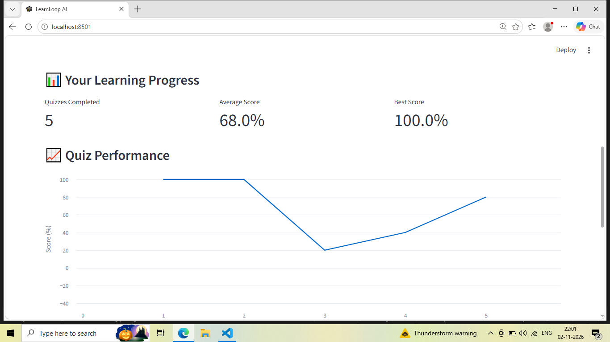
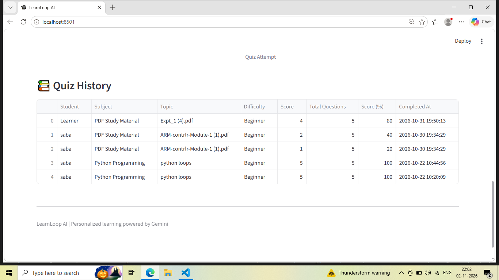

# LearnLoop AI

Your Personal AI Learning Assistant.

## About
LearnLoop AI is a GenAI-powered learning assistant that helps students understand topics, practice quizzes, and track their learning progress.

## Features
- AI-powered topic explanations
- PDF upload and content extraction
- Generate quizzes from uploaded PDFs
- Practice MCQ quizzes
- Score calculation and explanations
- Progress dashboard
- Quiz history tracking

## Technologies Used
- Python
- Streamlit
- Google Gemini API
- SQLite
- Pandas
- PyMuPDF

## How to Run

1. Clone the repository.
2. Install dependencies:
   pip install -r requirements.txt
3. Configure your Gemini API key in Streamlit secrets.
4. Run the application:
   streamlit run app.py
   
## Screenshots

### Home Page

### Practice Quiz

### Progress Dashboard

